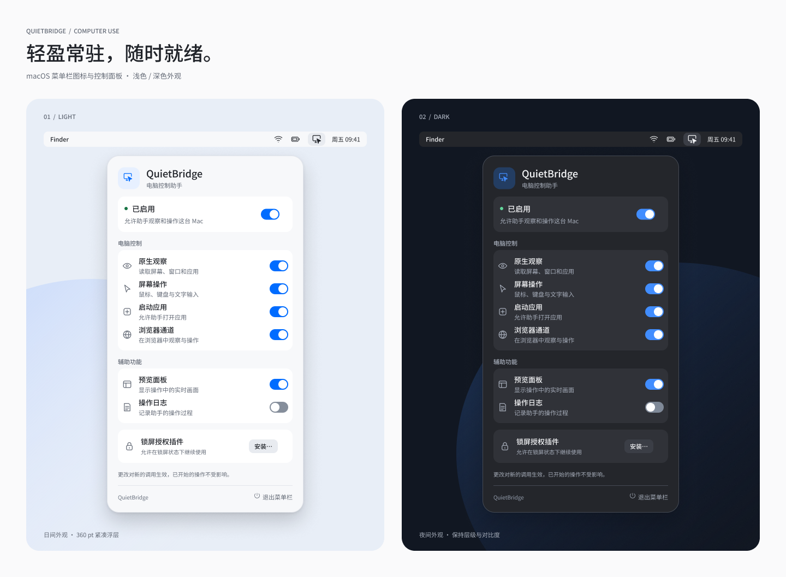
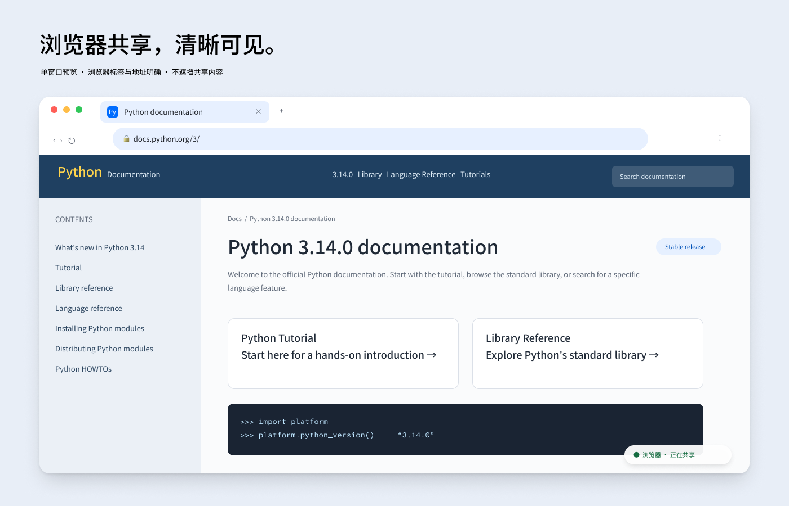

# QuietBridge

[简体中文](README.zh-CN.md)

QuietBridge connects AI agents to **background native-application and browser
operations on macOS**. It preserves the user's foreground application, keyboard
focus, physical pointer and current Space. Native operations use one explicitly
shared target window; browser operations use the Chrome extension and never fall
back to desktop input.

Current release: **0.6.29 (build 118)**. The locally built package is
`dist/quietbridge-0.6.29.pkg` (SHA256
`de679aea9de8d62affff2f97de77f24e74f16c06f3d6b9dd3ead12580fad85c7`). The app,
helper and authorization plug-in are Developer ID signed; the outer PKG is
intentionally unsigned and not notarized in this build.

## Product preview

[](https://www.figma.com/design/Tr6hAfLgUAulbXkagRyX3S?node-id=7-4)

[](https://www.figma.com/design/Tr6hAfLgUAulbXkagRyX3S?node-id=153-1092)

## What it provides

- **One macOS application** (`QuietBridge.app`, menu-bar accessory) with the
  signed native helper, permissions and an optional Locked-use authorization
  plug-in.
- **One Chrome extension** (`QuietBridge Browser`, MV3) that owns fixed-tab CDP
  operations, document binding, background popups and paged reads.
- **One host-neutral MCP service** (`services/mcp`) exposing 19
  `quietbridge_*` tools for apps, windows, tasks, AX state, screenshots,
  visual/video preview, click/type/paste/scroll/drag/hover, browser operations
  and recovery.
- **Host integrations**:
  - **Workbuddy**: MCP connector plus trusted lifecycle hooks.
  - **DeepSeek Harness 0.2.2-alpha.2**: an installable bundle
    (`@quietbridge/dsh`) with one MCP connector per Agent, trusted host-injected
    session identity, host-context turn routing and Agent-scoped tools.

## Status

| Host | Status |
| --- | --- |
| Workbuddy | Implemented; shares the application, extension and unified runtime |
| DeepSeek Harness | `implemented-real-profile-verified` on 0.6.29 (118): real-profile bundle installation, per-Agent connectors, 19 tools, turn lifecycle, restart recovery, multi-phase task protection and full browser operations were exercised on a real desktop |

Verified browser operations on the real extension include `create_target`,
`candidates`, `assign`, `verify_mapping` (window active-title, exact match),
`snapshot`, `read` (links/content), `screenshot`, `diagnostics`, `scroll`,
`keypress`, `click`, `navigate`, `tabs`, `select_tab`, `annotate`,
`annotations`, `fill` and `select`. A local form test confirmed
`fill + select + click` end to end.

Known limits (not claimed): DSH native preview host-window binding, image
attachments projected as model attachments (the bridge returns text plus a
saved PNG path), real-profile multi-Agent concurrency/long soak, real Workbuddy
multi-session/preview visual acceptance, and outer-PKG signing/notarization.

## Unified runtime

Everything lives under one directory:

```
~/Library/Application Support/QuietBridge/
├── connector/                 # stable headless MCP connector
├── extension/native-host/     # Chrome native-messaging host (single registration)
├── releases/<digest>/         # verified app copy + rendered DSH bundle
├── sessions/<key>/            # per-host-session task channels
├── host-lifecycle/            # turn/task receipts used by host routing
├── browser-events.json        # extension heartbeat / candidate evidence
├── task-windows.json          # native task bindings
└── logs/                      # bridge / native operation logs
```

Chrome registers exactly one native host (`com.cua.browser_observer`) pointing at
this runtime. Legacy `WorkbuddyExtension` / `QuietBridgeBrowser` storage is used
only as a one-time migration source; it is not a second live host. Tool names are
`quietbridge_*`; legacy `cua_*` calls and stored connection settings remain
accepted aliases.

## Requirements

- Apple Silicon, macOS 14+
- Swift 6 for the native app
- Python 3.9+ (system Python is fine; the installed app uses `/usr/bin/python3`)
- Node.js for extension/bundle tests
- Chrome 106+ for browser tasks
- DeepSeek Harness 0.2.2-alpha.2 for the DSH integration

## Build and test

Run from the repository root:

```sh
swift build --package-path apps/macos --configuration release
python3 apps/macos/tests/test_swift.py

python3 -m unittest discover -s services/mcp -p 'test_*.py' -q          # 495 tests
python3 -m unittest discover -s packaging/macos -p 'test_*.py' -q      # 57 tests
node --test extensions/chromium/*.test.mjs                             # 117 tests
node --test adapters/deepseek_harness/bundle/test/*.test.mjs           # 44 tests

# Optional: temporary DSH_HOME/profile; never reads or writes ~/.dsh.
env -u DSH_HOME -u PYTHONPATH python3 tools/dsh_isolated_check.py --agents 3
```

Build a shared installer:

```sh
python3 packaging/macos/build.py --version 0.6.29 --build 118 \
  --identity 'Developer ID Application: …' --profiles-dir sign
```

The result is `dist/quietbridge-0.6.29.pkg`. Building does not claim that the
outer PKG is signed; signing and notarization are separate release steps.

## Install

1. Open `dist/quietbridge-0.6.29.pkg` and install.
2. Grant **Accessibility** and **Screen Recording** to QuietBridge when asked.
3. Load/enable the **QuietBridge Browser** extension in Chrome and grant site
   access for pages you want an agent to operate.
4. For DeepSeek Harness, add the deployed bundle to the profile (after a package
   install the postinstall log prints the exact command):

```sh
REL=$(ls -dt "$HOME/Library/Application Support/QuietBridge/releases"/* | head -1)
"/Applications/DeepSeek Harness.app/Contents/Resources/runtime/cli/bin/dsh" \
  plugin --profile <profile> add "$REL/dsh-bundle"
```

5. Restart DeepSeek Harness (and Chrome after the first install so the native-host
   registration is reloaded).

To render a bundle for manual installation without writing a DSH profile:

```sh
python3 install.py --install --dsh-bundle /path/to/rendered-bundle \
  --dsh-helper '/Applications/QuietBridge.app/Contents/MacOS/quietbridge-native'
```

## Repository

| Directory | Responsibility |
| --- | --- |
| `apps/macos` | Native app, menu panel, permissions, native executor and preview |
| `services/mcp` | Host-neutral MCP tools, task state, browser messaging and recovery |
| `extensions/chromium` | QuietBridge Browser: fixed-tab CDP operations and observation |
| `system/authorization-plugin` | Optional signed authorization plug-in for Locked use |
| `adapters/workbuddy` | Workbuddy MCP settings and trusted lifecycle hooks |
| `adapters/deepseek_harness` | DSH contract, per-Agent connector adapter and installable bundle |
| `products` | Host product metadata and publication boundaries |
| `packaging/macos` | Shared PKG assembly, transactional user-file deployment and recovery |
| `tools` | Release layout, isolated DSH check and developer utilities |
| `docs` | Architecture, host contract, implementation records and release notes |

`project.json` defines product names and implementation status. The folder
containing a checkout is arbitrary; no developer-specific absolute path is
required to build the project.

## Documentation

- [Architecture](docs/architecture/quietbridge.zh.md) and
  [multi-agent runtime](docs/architecture/multi-agent-runtime.zh.md)
- [DeepSeek Harness host contract](docs/architecture/dsh-host-contract.zh.md)
- [DSH isolated verification](docs/implementation/2026-11-15-dsh-isolated-verification.zh.md)
- [DSH real-profile test record](docs/implementation/2026-11-15-dsh-real-profile-test.zh.md)
- [DSH PKG deployment](docs/implementation/2026-11-15-dsh-pkg-deploy.zh.md)
- [Release notes 0.6.29](docs/releases/0.6.29.zh.md)

## Compatibility

New tools use `quietbridge_*`. Existing `cua_*` calls remain accepted as aliases;
existing owned connection keys, environment settings and stable connector paths
remain supported. Bundle identifiers are now `com.quietbridge.app`,
`com.quietbridge.helper` and `com.quietbridge.AuthorizationPlugin`; the Developer
ID team remains unchanged. macOS permissions must be checked and granted again
for the new identity. Existing authorization plug-ins need an explicit update
through the app's manager and a logout/login; the main PKG does not activate or
rewrite system authorization policy.

## Attribution

Third-party attribution is kept in `apps/macos/upstream.json` and
`apps/macos/LICENSE.cua-driver`.
